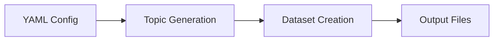

# generate

The `generate` command executes the complete synthetic data generation pipeline from YAML configuration to finished dataset. This command represents the primary interface for transforming domain concepts into structured training data through topic modeling and content generation.



The generation process operates through multiple stages that can be monitored in real-time, providing visibility into topic expansion, content creation, and quality control measures.

## Basic Usage

Generate a complete dataset from a configuration file:

```bash title="Basic generation"
deepfabric generate config.yaml
```

This command reads your configuration, generates the topic structure, creates training examples, and saves all outputs to the specified locations.

## Configuration Override

Override specific configuration parameters without modifying the configuration file:

```bash title="Override parameters"
deepfabric generate config.yaml \
  --provider anthropic \
  --model claude-sonnet-4-5 \
  --temperature 0.8 \
  --num-samples 100 \
  --batch-size 5
```

!!! tip "Experimentation"
    Configuration overrides apply to all stages, enabling experimentation with different settings while maintaining the base configuration.

## File Management Options

Control where intermediate and final outputs are saved:

```bash title="Custom output paths"
deepfabric generate config.yaml \
  --topics-save-as custom_topics.jsonl \
  --output-save-as custom_dataset.jsonl
```

!!! note "Output Organization"
    These options override the file paths specified in your configuration, useful for organizing outputs by experiment or preventing accidental overwrites.

## Loading Existing Topic Structures

Skip topic generation by loading previously generated topic trees or graphs:

```bash title="Load existing topics"
deepfabric generate config.yaml --topics-load existing_topics.jsonl
```

!!! tip "Faster Iteration"
    This approach accelerates iteration when experimenting with dataset generation parameters while keeping the topic structure constant.

See [Sample Generation Modes](../dataset-generation/sampling-modes.md) to choose independent,
sequential, bulk/seed or bulk/full generation. Bulk collection budgets scale by the number
requested unless `generation.bulk.max_tokens_per_call` supplies a fixed ceiling.

## Topic-Only Generation

Generate and save only the topic structure without proceeding to dataset creation:

=== "Graph Mode (Default)"

    ```bash
    deepfabric generate config.yaml --topic-only
    ```

=== "Tree Mode"

    ```bash
    deepfabric generate config.yaml --mode tree --topic-only
    ```

The `--topic-only` flag stops the pipeline after topic generation and saves the topic structure to the configured location.

## Topic Modeling Parameters

Fine-tune topic generation behavior through command-line parameters:

```bash title="Topic parameters"
deepfabric generate config.yaml \
  --degree 5 \
  --depth 4 \
  --temperature 0.7
```

| Parameter | Effect |
|-----------|--------|
| `--degree` | More subtopics per node (broader exploration) |
| `--depth` | More levels of detail (deeper exploration) |
| `--temperature` | Higher values create more diverse topics |

## Dataset Generation Controls

Adjust dataset creation parameters for different scales and quality requirements:

```bash title="Generation controls"
deepfabric generate config.yaml \
  --num-samples 500 \
  --batch-size 10 \
  --no-system-message
```

| Parameter | Description |
|-----------|-------------|
| `--num-samples` | Total samples: integer, `auto`, or percentage (e.g., `50%`, `200%`) |
| `--batch-size` | Maximum concurrent topic tasks; samples within a topic are sequential |
| `--include-system-message` | Include system prompts in training examples |
| `--no-system-message` | Exclude system prompts from training examples |

!!! tip "Automatic Sample Count"
    Use `--num-samples auto` to allocate one sample per unique topic (tree leaf or non-root graph node). Use `--num-samples 50%` to select the existing ordered prefix, or `--num-samples 200%` for two slots per topic in one pass. Terminal failures can reduce successful output rows.

    Integer targets use the same allocation: `--num-samples 100` with 50 unique topics is equivalent to `--num-samples 200%`. Targets are never rounded to a batch multiple.

## Conversation Type Options

Control the type of conversations generated:

```bash title="Conversation options"
deepfabric generate config.yaml \
  --conversation-type cot \
  --reasoning-style freetext
```

| Option | Values | Description |
|--------|--------|-------------|
| `--conversation-type` | `basic`, `cot` | Base conversation type |
| `--reasoning-style` | `freetext`, `agent` | Reasoning style for cot |

!!! note "Agent Mode"
    Agent mode is automatically enabled when tools are configured. No explicit `--agent-mode` flag is required. The `--agent-mode` flag is deprecated.

## TUI Options

Control the terminal user interface:

=== "Rich TUI"

    ```bash
    deepfabric generate config.yaml --tui rich
    ```

    Two-pane interface with real-time progress (default).

=== "Simple Output"

    ```bash
    deepfabric generate config.yaml --tui simple
    ```

    Headless-friendly plain text output.

## Provider and Model Selection

Use different providers or models for different components:

```bash title="Provider selection"
deepfabric generate config.yaml \
  --provider openai \
  --model gpt-4 \
  --temperature 0.9
```

!!! info "Provider Scope"
    Provider changes apply to all components unless overridden in the configuration file.

## Complete Example

??? example "Comprehensive generation command"

    ```bash title="Full example"
    deepfabric generate research-dataset.yaml \
      --topics-save-as research_topics.jsonl \
      --output-save-as research_examples.jsonl \
      --provider anthropic \
      --model claude-sonnet-4-5 \
      --degree 4 \
      --depth 3 \
      --num-samples 200 \
      --batch-size 8 \
      --temperature 0.8 \
      --include-system-message
    ```

    This creates a research dataset with comprehensive topic coverage and high-quality content generation.

## Prompt Tracing and Dry Runs

DeepFabric builds prompts from default templates using your configuration and
topic context.

Use `--trace-prompt` to save the prompts used during topic graph/tree generation,
expansion, and sample generation:

```bash
deepfabric generate config.yaml --trace-prompt
```

By default, only the first prompt for each stage (such as topic expansion or
sample generation) is recorded per run. Add `--verbose` to record every prompt:

```bash
deepfabric generate config.yaml --trace-prompt --verbose
```

The trace file location is chosen in this order:

1. `--trace-prompt-file PATH`
2. `DEEPFABRIC_PROMPT_TRACE_FILE`
3. `./prompt-trace.jsonl` in your current working directory

```bash
deepfabric generate config.yaml --trace-prompt --trace-prompt-file ./inspect.jsonl
```


Traces are appended to the JSONL file without interrupting the 
progress display. The parent directory must already exist.

To change topic or sample-generation templates, supply your own inline text or
template files in YAML. See [prompt templates](../dataset-generation/prompt-templates.md).

### Preview without generating data

Use `--dry-run` to print prompts in the terminal without calling models,
executing tools, or creating topic and dataset files:

```bash
deepfabric generate config.yaml --dry-run
```

Values that depend on earlier steps use placeholders such as `{{{topic path}}}`
and `{{{tool result}}}`. Add `--verbose` to preview representative later cases,
or `--trace-prompt` to also save the previews to a file.

With `--topics-load`, bulk previews calculate the collection count from the loaded
topics and requested sample count. Otherwise, the count remains a placeholder.
Later collection previews show a retry, including accepted seeds only when a
previous response was partially successful.

## Progress Monitoring

The generation process provides real-time feedback:

- :material-file-tree: Topic tree construction progress with node counts
- :material-percent: Dataset generation status with completion percentages
- :material-alert: Error reporting with retry attempts and failure categorization
- :material-chart-bar: Final statistics including success rates and output file locations

### Token usage and run reports

After generation, DeepFabric prints the input, output and total token counts
reported by providers. With checkpointing enabled, the summary shows both the
current invocation and cumulative observed usage across resumes. Reasoning and
cache counts are already included in the totals, so do not add them again.

To keep these counts along with request timing, retries, sample outcomes and
topic-to-output-row mappings, use `--run-report`. The report is saved beside the
dataset as `<output-stem>.report.json`, or at a path you supply:

```bash
deepfabric generate config.yaml --run-report
deepfabric generate config.yaml --run-report results/run.report.json
```

The report also includes input hashes and sampling settings. Its events describe
the current invocation; cumulative token counts cover the recorded checkpoint
history. Loading a saved graph does not add its historical token usage, though
topic generation performed during this invocation is counted.

These counts reflect observed usage rather than a complete billing record.
Missing provider usage and usage from runs before accounting was recorded remain
unknown, and SDK-internal retries and direct streaming usage may be unobservable.
DeepFabric marks incomplete counts and does not estimate dollar costs.

No report file is created unless requested, and dry runs do not write reports.
Reports do not require `--debug`; use `--trace-prompt` separately to record prompts.
After a successful run, DeepFabric prints the totals and saves any requested
report before removing the checkpoint. If the report cannot be saved, it retains
the checkpoint so the recorded usage is preserved.

## Checkpoint and Resume

For long-running generation jobs, enable checkpointing to save progress and allow resuming after interruptions:

```bash title="Enable checkpointing"
deepfabric generate config.yaml --checkpoint-interval 500
```

If generation is interrupted, resume from the checkpoint:

```bash title="Resume from checkpoint"
deepfabric generate config.yaml --resume
```

To retry previously failed samples when resuming:

```bash title="Resume with retry"
deepfabric generate config.yaml --resume --retry-failed
```

| Parameter | Description |
|-----------|-------------|
| `--checkpoint-interval N` | Save checkpoint every N samples |
| `--checkpoint-path PATH` | Override checkpoint directory (rarely needed) |
| `--resume` | Resume from existing checkpoint |
| `--retry-failed` | Implies `--resume`; process outstanding slots and retry previously failed slots |

!!! info "Checkpoint Location"
    Checkpoints are stored in an XDG-compliant location: `~/.local/share/deepfabric/checkpoints/` (or `$XDG_DATA_HOME/deepfabric/checkpoints/`). Each config file gets its own subdirectory based on a hash of its path, so different projects don't interfere with each other.

!!! tip "Checkpoint Status"
    Use `deepfabric checkpoint-status config.yaml` to inspect checkpoint progress without resuming.

### How Checkpointing Works

Checkpointing saves progress at regular intervals:

1. **Samples file** - Incrementally appends successful samples (no write amplification)
2. **Failures file** - Records failed samples with error details
3. **Metadata file** - Tracks progress, processed paths, and generation config

On resume, the generator:

- Loads previously processed topic paths
- Skips already-completed work
- Continues from where it left off
- Optionally retries failed samples with `--retry-failed`

After generation completes, DeepFabric removes the checkpoint once the output is saved successfully and no failed slots remain. If failures remain, the checkpoint is kept so they can be retried.

!!! info "Memory Optimization"
    Checkpointing periodically flushes samples to disk, reducing sample buffering during generation. Completion identities remain in memory, and final dataset assembly loads the saved rows.

### Migrating Older Checkpoints

Version 4 checkpoints require migration before resuming. See [Migrating Version 4 Checkpoints](../dataset-generation/configuration.md#migrating-version-4-checkpoints) for the helper command and required inputs.

### Graceful Stop

Press ++ctrl+c++ once during generation to request a graceful stop. The generator will:

1. Complete the current batch
2. Save a final checkpoint
3. Exit cleanly

The TUI status panel shows "Stopping: at next checkpoint" to confirm the stop is pending. Press ++ctrl+c++ a second time to force quit immediately (no checkpoint saved).

### Existing checkpoints

If you start generation without `--resume` but a checkpoint already exists for that configuration, DeepFabric prompts you to choose how to continue. The prompt will look something like this:

```text
⚠ Existing checkpoint found for this configuration: 3 successful samples, 1 failed, 2 outstanding.

  1) Resume without retrying failed samples [default]
  2) Resume and retry failed samples
  3) Clear checkpoint and start fresh
  4) Abort

  Choose [1/2/3/4] (auto-1 in 20s):
```

The choices and default depend on the saved checkpoint state, as shown below. 

| Saved state | Choices | Default |
| --- | --- | --- |
| Only failed slots remain | Retry failed samples / Clear checkpoint and start fresh / Abort | Retry failed samples |
| Failed and outstanding slots remain | Resume without retrying failed samples / Resume and retry failed samples / Clear checkpoint and start fresh / Abort | Resume without retrying failed samples |
| Outstanding slots remain without failures | Resume from checkpoint / Clear checkpoint and start fresh / Abort | Resume from checkpoint |
| All slots succeeded | Save samples to output and remove checkpoint / Clear checkpoint and start fresh / Abort | Abort for a plain invocation; save for explicit `--resume`/`--retry-failed` |

This occurs before DeepFabric generates or saves topics to prevent accidental override.

Explicit `--resume` bypasses the prompt unless only failed slots remain or all slots succeeded. Enabling retries with `--retry-failed` or `output.checkpoint.retry_failed: true` bypasses it unless all slots succeeded.

If saving or cleanup fails or is interrupted, a fully successful checkpoint may remain. The save option validates the topics and plan, saves samples to the output path selected by the config or `--output-save-as`, then removes the checkpoint.

On POSIX systems the displayed default is selected after 20 seconds or immediately at EOF, including closed stdin in CI. The default is chosen to offer a useful continuation in any case.

If no checkpoint is available, `--resume`, `--retry-failed`, and their combination fall back to fresh generation. If an existing checkpoint cannot be loaded (for example a version 4 checkpoint, or metadata damaged by an interrupted write), DeepFabric shows its path and the reason, and offers *Clear checkpoint and start fresh* or *Abort*. Abort is the default and exits with status 1 without changing any files; a version 4 checkpoint can be migrated instead of cleared. If the saved topic graph or tree is missing when resuming, DeepFabric exits with an error asking you to provide the original file via `--topics-load`.


## Error Recovery

!!! warning "Partial Failures"
    When generation fails partway through, the system saves intermediate results where possible. Topic trees are saved incrementally, enabling recovery by loading partial results and continuing from the dataset generation stage. With checkpointing enabled, dataset generation progress is also preserved.

Generation errors and handled interruptions can also save partial dataset exports. See [Partial Results After Errors or Interruptions](../dataset-generation/configuration.md#partial-results-after-errors-or-interruptions) for filenames and recovery behavior.

??? tip "Optimizing Generation Performance"
    Balance `batch-size` with your API rate limits and system resources. Larger batches increase throughput but consume more memory and may trigger rate limiting. Start with smaller batches and increase based on your provider's capabilities.

## Output Validation

After generation completes, verify your outputs:

```bash title="Validation commands"
# Check dataset format
head -n 5 your_dataset.jsonl

# Validate JSON structure
python -m json.tool your_dataset.jsonl > /dev/null

# Count generated examples
wc -l your_dataset.jsonl
```

## Topic Inspection

After generating topics, explore and refine the structure before dataset generation:

```bash title="Inspect and prune workflow"
# Explore the topic structure
deepfabric topic inspect topics.json --level 1 --expand

# Preview what pruning would remove
deepfabric topic prune topics.json --level 2 --dry-run

# Prune and save to new file
deepfabric topic prune topics.json --level 2 -o pruned_topics.json
```

See [topic inspect](topic-inspect.md) and [topic prune](topic-prune.md) for full details.
